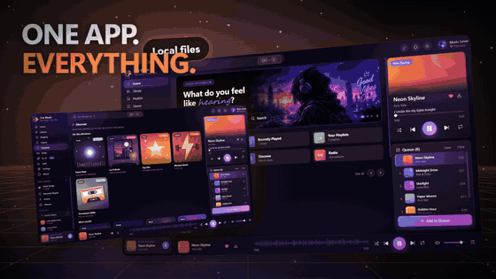
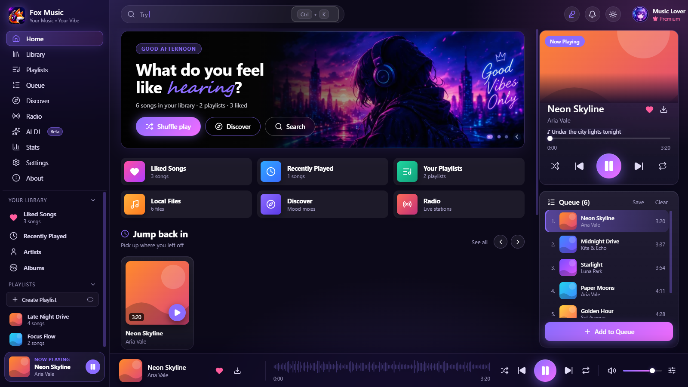
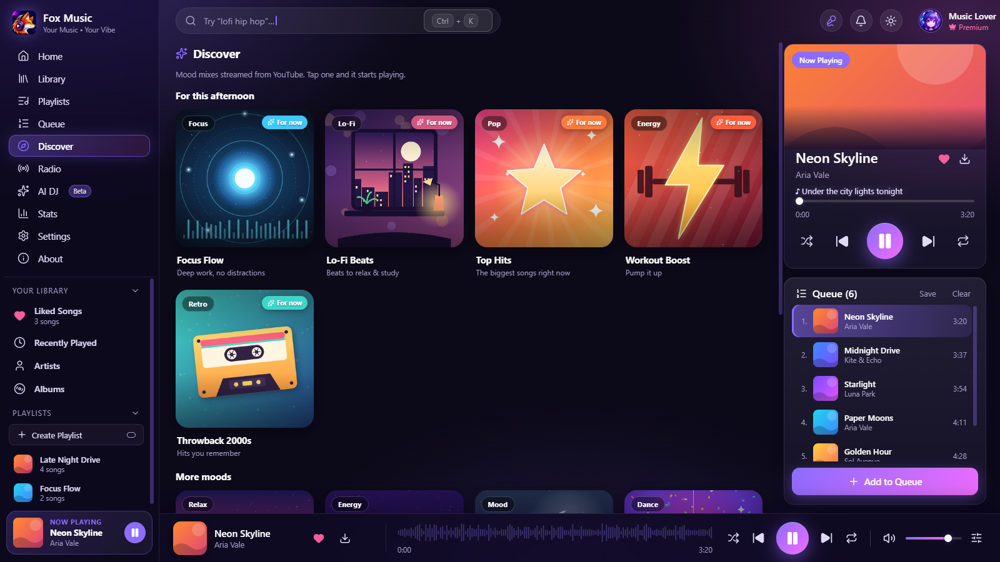
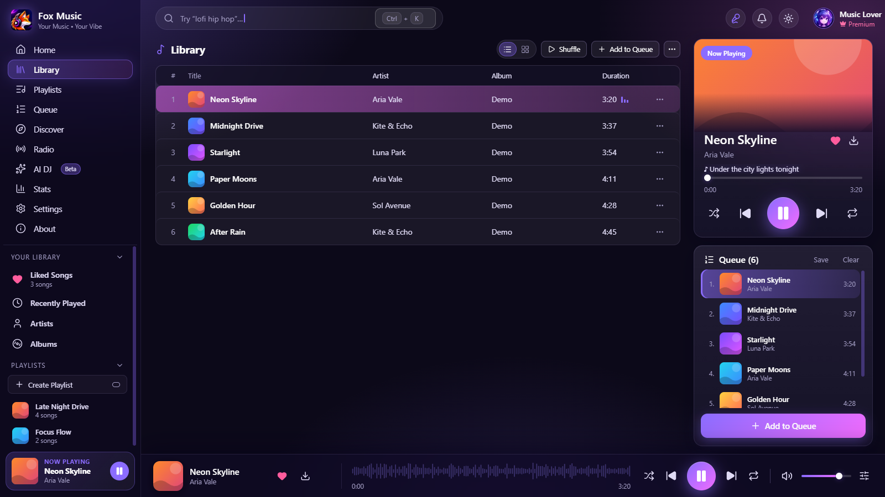
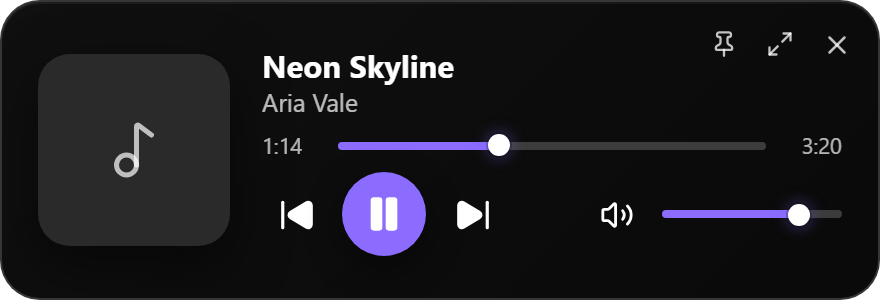
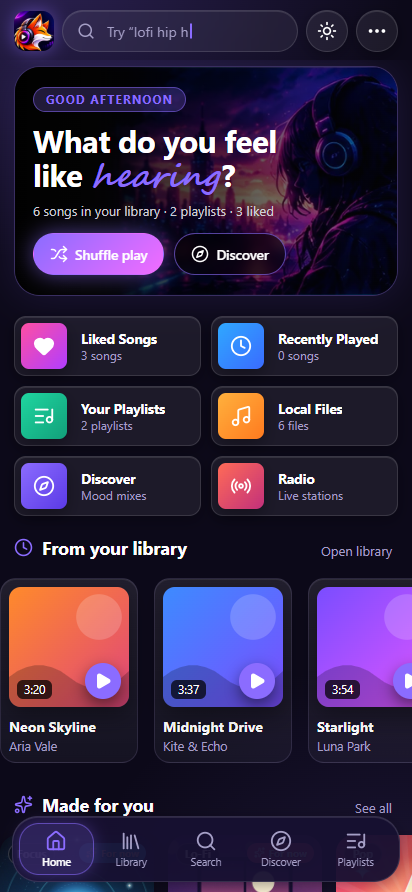
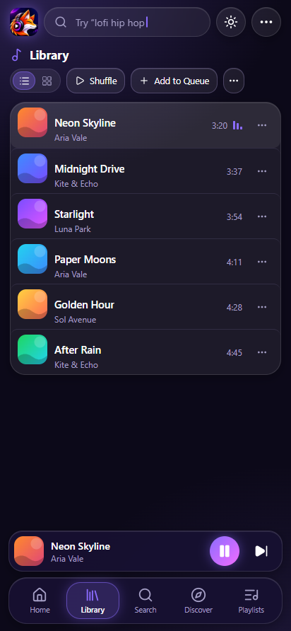
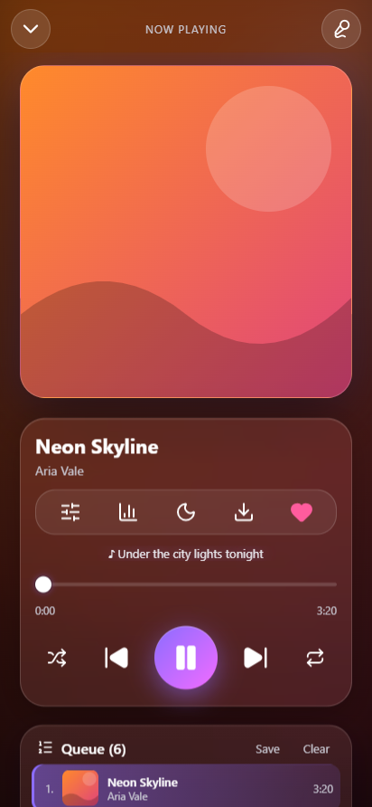

 

  

## ✨ See it in action

  
   
  Desktop app → full-screen lyrics → mini player (cut from the 44-second promo video)

 

  

  
   <b>Made for you</b> - illustrated mood mixes, the ones that suit the time of day first

<table>
  <tr>
    <td width="50%"> <b>Library</b> - your files and every download, with a Now Playing card</td>
    <td width="50%" align="center"> <b>Mini player</b> - tiny, always on top (Windows &amp; Mac)</td>
  </tr>
</table>

  
  
  
   <b>Android</b> - violet glass look, background play with lock-screen controls and the equalizer

## 🚀 Features

| | Feature | What you get |
|:-:|---|---|
| 🎵 | **Library + YouTube** | Add songs or folders (drag & drop works) or search any song on YouTube and play it instantly. |
| 🎤 | **Full-screen lyrics** | Big synced lines that glow with the song, cover-colour backdrop, tap a line to seek. Press <kbd>L</kbd>. |
| 🔎 | **Lyrics almost everywhere** | Smart title cleaning, then LRCLIB → NetEase → lyrics.ovh, so far fewer "not found". |
| 🪟 | **Mini player** | The whole app shrinks into a small always-on-top player with seek, volume and controls. |
| ⬇️ | **Downloads → library** | Save a YouTube song and it lands in **Library → Local files** automatically, ready offline. |
| 🔥 | **A busy Home** | *Because you listened*, *Trending now*, *Hot in India*, mood mixes, radio. |
| 🎁 | **Made for you** | Twelve illustrated mood mixes (Chill, Focus, Lo-Fi, Workout, Party, Sleep and more). The ones that suit the time of day come first, and one tap starts playing. |
| ✨ | **AI DJ & mixes** | Local smart shuffle and mood mixes - nothing is sent to an AI service. |
| 🎨 | **Aurora glass look + 17 looks** | A glowing frosted-glass design in violet, plus AMOLED, Midnight, Ocean, Forest, Rose, Sunset, Mocha, Nord, Dracula, Neon, Paper, Cream, Mint, Sky, Lavender, Peach and 17 accent colours. Write your own theme as a small JSON file. |
| 🔋 | **Android background play** | Foreground service, wake & Wi-Fi locks, lock-screen controls, battery-optimisation helper. |
| 🎚️ | **Sound studio** | 10-band equalizer with presets and bass boost (desktop **and Android**), volume normalizer, speed 0.5-2x with Nightcore / Slowed, crossfade up to 12 s, gapless playback. Press <kbd>E</kbd>. |
| 🧠 | **A smarter queue** | No duplicates, **Play next** that keeps its order (also while shuffling), drag to reorder, one-tap "play next" on any queued song, and adding to an empty queue starts playing. |
| 🪄 | **yt-dlp included** | The Windows app ships with yt-dlp and keeps it up to date by itself - nothing to install by hand. |
| 🧷 | **Tray icon** | Close the window and the music keeps playing from the tray (Windows / Linux); play, next and previous are in its menu. |
| ∞ | **Auto-DJ** | When the queue ends, similar songs are added from YouTube so the music never stops. |
| 📊 | **Listening stats** | Hours listened, 7-day chart, top songs and artists, streak, and a shareable image card. All on your device. |
| ⏰ | **Wake-up alarm** | Wake up to your own music, volume rising slowly, snooze, repeat days. On Android it opens the app even when it is closed. |
| ▶️ | **Resume where I left** | Open the app and the queue and position come back. |
| 🚀 | **Fast** | Search answers in about a second on desktop (was ~6 s), next songs are prepared in advance, and libraries with thousands of songs scroll smoothly. |
| 🧩 | **Plugins** | One-file plugins add lyrics sources, Home rows and buttons. Each runs in a locked-down worker and asks for permissions you see before installing. Guide: [`docs/PLUGINS.md`](docs/PLUGINS.md). |
| 📱 | **Phone remote + HTTP API** | Scan a QR code and control the player from your phone's browser on the same Wi-Fi: play, seek and volume, queue reordering, play next, like, a sleep timer, and "add to home screen". The link has a secret key; a small HTTP API comes with it. *(desktop)* |
| 🤖 | **MCP server** | Lets AI assistants such as Claude search, play and queue songs. Only reachable from your own computer. *(desktop)* |
| 🎤 | **Artist pages** | Photo, bio, albums and popular songs from MusicBrainz and Wikipedia. Tap an artist name. |
| 🗂️ | **Playlists, properly** | Folders, import a YouTube playlist (desktop) or a JSON file, export, and save the queue as a playlist. |
| 💾 | **Backup & restore** | Library, playlists, stats and settings in one file. |
| 🔁 | **Wrong version?** | Pick another YouTube video for a song; the app remembers it. |
| 🌈 | **Visualizer** | Full-screen ring or bars, real spectrum for your own files (<kbd>V</kbd>). |
| 🔗 | **ListenBrainz and Discord** | Optional: send your listening to ListenBrainz and show "Listening to…" on Discord (desktop). |
| 🎹 | **Your own shortcuts, better lyrics** | Rebind every key; nudge lyric timing per song, change text size, switch auto-scroll. |
| 🌙 | **Sleep timer** | 5 min - 12 h, end of song / queue, or N songs. Volume fade-out, last-song fade, one-tap +10 min card, offline rain / ocean / fan sounds, Android notification countdown. Press <kbd>T</kbd>. |
| 🔔 | **Update notice** | Windows and Android tell you when a new version is out (once a day, or **About → Check for updates**). You choose when to download. |
| 🔒 | **Private by design** | No account, no ads, no analytics. Your library stays on your device. |

<b>🎹 Keyboard shortcuts</b>

 

| Key | Action | Key | Action |
|---|---|---|---|
| <kbd>Space</kbd> | Play / pause | <kbd>L</kbd> | Full-screen lyrics |
| <kbd>←</kbd> <kbd>→</kbd> | Seek 5 s | <kbd>Shift</kbd>+<kbd>←</kbd>/<kbd>→</kbd> | Previous / next |
| <kbd>↑</kbd> <kbd>↓</kbd> | Volume | <kbd>M</kbd> | Mute |
| <kbd>S</kbd> | Shuffle | <kbd>Ctrl</kbd>+<kbd>K</kbd> | Search |
| <kbd>T</kbd> | Sleep timer | <kbd>E</kbd> | Sound (equalizer, speed) |
| <kbd>V</kbd> | Visualizer | <kbd>/</kbd> | Search |

Every key can be changed in **Settings → Shortcuts** (desktop).

## ⬇️ Download

| Platform | File | Notes |
|:-:|---|---|
| 🪟 **Windows** | `Fox-Music-<version>-Windows-x64.exe` · `...-Windows-Portable.exe` | Windows 10/11, 64-bit. Custom setup wizard. |
| 🤖 **Android** | `Fox-Music-<version>-Android.apk` | Android 8+. Allow *Install unknown apps* when asked. |
| 🍎 **macOS** | `...-macOS-arm64.dmg` · `...-macOS-x64.dmg` | Build it on a Mac with one command (`bash tools/build-mac.sh`), or see below. |

👉 **Get them from the [Releases page](../../releases/latest).**
👉 **Get them from the [WEBSITE](https://foxmusic.in/).**

> [!NOTE]
> The apps are not code-signed yet. Windows shows a SmartScreen notice once - click **More info → Run anyway**. On a Mac, right-click the app → **Open** (or run `xattr -cr "/Applications/Fox Music.app"`).

Have an idea? Tell us on **[Discord](https://discord.gg/weRFDT6Ppf)** or open an issue.

## ❓ FAQ

<b>Where do my downloads go?</b>

 Windows/Mac: <code>Music\Fox Music</code>. Android: <code>Music/Fox Music</code>. They are also added to <b>Library → Local files</b> automatically.

<b>Music stops with the screen off on Android</b>

 Open <b>Settings → Background play → Allow</b> and, on phones with strict battery savers (Xiaomi, Oppo, Vivo, Samsung), set the app's battery to "No restrictions".

<b>Lyrics are missing for a song</b>

 The app searches LRCLIB, NetEase and lyrics.ovh (and any lyrics plugin you installed). If none has it you will see "No lyrics found". If the words are slightly early or late, nudge them with + / − in the lyrics screen.

<b>How do I use my phone as a remote?</b>

 Desktop app → <b>Settings → Connections → Phone remote</b>, then scan the QR code (same Wi-Fi). Windows may ask to allow the app through the firewall: choose "Private networks".

<b>Are plugins safe?</b>

 Each plugin runs in a restricted worker and can only do what it asked for (you see the list before installing). It is still someone else's code, so install plugins only from people you trust. See <a href="docs/PLUGINS.md">docs/PLUGINS.md</a>.

<b>Is it really free? Where does the music come from?</b>

 Yes - free, no ads. Fox Music plays files you own and public YouTube content you choose. It does not host any music.

## 🔐 Privacy

No accounts, no ads, no analytics. The library, playlists, stats and settings stay on your device. The app goes online only for YouTube, lyrics and artist pages, or for extras you switch on yourself (ListenBrainz, Discord status, plugins). Full details: [Privacy Policy](https://foxmusic.in/privacy.html).

## 📜 Licence & credits

Proprietary - free for personal, non-commercial use (see [`LICENSE`](LICENSE)). Built with Electron, React, Vite, Capacitor, [NewPipe Extractor](https://github.com/TeamNewPipe/NewPipeExtractor), [yt-dlp](https://github.com/yt-dlp/yt-dlp), Lucide icons, music-metadata and qrcode-generator. Lyrics from [LRCLIB](https://lrclib.net); artist facts from [MusicBrainz](https://musicbrainz.org) and short bios from Wikipedia (CC BY-SA, with a link to the source); scrobbling to [ListenBrainz](https://listenbrainz.org). YouTube is a trademark of Google LLC; this project is not affiliated with YouTube or Google.

**Made with ♥ by [Ashborn](https://github.com/ashbornofficial)** · [Discord](https://discord.gg/weRFDT6Ppf)

If you like it, drop a ⭐ on the repo - it really helps.

